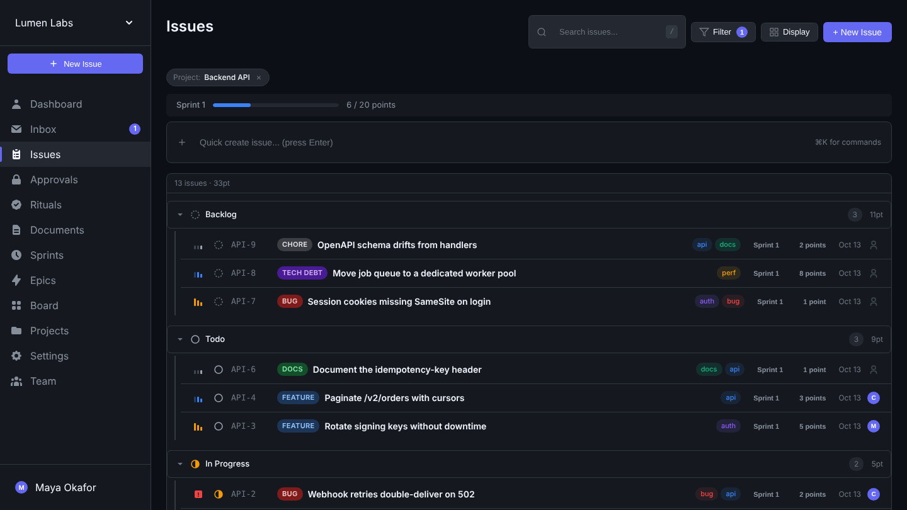

# Chaotic

**Agent-first project infrastructure.** You build the physics. Agents learn the rules.

Chaotic is a self-hosted issue tracker and project management tool designed for AI coding agents. Humans control the environment through budgets, rituals, and gates. Agents navigate that environment through a CLI that enforces the rules with hard stops, not suggestions.



<sub>More screenshots, including the approvals queue, are on [chaotic.sh](https://chaotic.sh/#product). The data shown is made up.</sub>

## Why Chaotic?

AI agents will work forever if you let them. They'll close 15 tickets without pausing to ask "should I run the tests?" or "is this the right architecture?" And you won't know what happened until you review a massive PR.

Chaotic solves this with **structural constraints**:

- **Sprint budgets** create resource limits. When the budget is spent, the CLI blocks further work.
- **Arrears** force stopping points. The agent must close the sprint to continue.
- **Limbo** creates transition gates. A closed sprint can't become a new one until rituals are completed.
- **Rituals** inject reflection. The agent must attest to actions (run tests, review architecture, reprioritize backlog) before moving on.
- **Human gates** add verification where you want it. Any ritual can require human approval.

The agent experiences all of this as normal CLI behavior: commands that succeed, commands that fail with actionable error messages.

```
$ chaotic issue update CHT-42 --status done
Error: Sprint is in arrears (budget: 10, spent: 13, arrears by: 3).
Close the current sprint to continue.

$ chaotic sprint close
Sprint "Sprint 4" closed. Status: limbo
Pending rituals: run-tests, architecture-review
Complete all rituals to exit limbo.

$ chaotic ritual attest run-tests --note "All 847 tests passing"
Ritual attested. 1/2 rituals complete.
```

## Quick Start

### One-line install

```bash
curl -sSL https://chaotic.sh/install.sh | sh
```

This installs the CLI and sets up a local server.

### Manual install

Prerequisites: Python 3.10+, git, [uv](https://docs.astral.sh/uv/), [just](https://github.com/casey/just)

```bash
uv tool install chaotic-cli
chaotic system install
```

Then set up your account:

```bash
chaotic auth signup --name "Your Name" --email you@example.com --password "a strong password"
chaotic team create "My Team" TEAM
chaotic init
```

(Or skip typing out flags and run `chaotic quickstart` instead, which walks
through account/team/project setup interactively.)

Open http://localhost:24267 for the web UI.

By default the server binds to `127.0.0.1` (localhost only). If you're
running this on a box you plan to reach over a network, read
[docs/self-hosting-security.md](docs/self-hosting-security.md) first.

### Talking to your tracker from an agent

`chaotic mcp` gives any local MCP-speaking harness (Claude Code, etc.)
native chaotic tools over stdio. If your chaotic instance is reachable
over the network (deployed somewhere, tunneled, whatever), it also
speaks MCP directly over Streamable HTTP at `/mcp`.

The recommended way to connect a hosted client (claude.ai custom
connectors, Claude Desktop, ChatGPT, or `claude mcp add --transport
http`) is to add it by URL and authorize: give the client
`https://your-chaotic-host/mcp` and nothing else, and it sends you to a
Chaotic consent page in your browser where you pick the agent it acts
as. claude.ai, Claude Desktop and ChatGPT connect from their own
servers, so they need your server on the public internet over https;
Claude Code also works against `http://localhost`. This needs OAuth
turned on, which is off by default: on an installed server, run
`chaotic system config set APP_BASE_URL https://your-chaotic-host`, then
`chaotic system config set OAUTH_ENABLED true`, then restart the server
(`chaotic system stop` and `chaotic system start`); on a server you run
by hand, set the same two in its environment or `backend/.env`. API keys
(`chaotic auth keys create "..." --expires-in 90d`, sent as an
`Authorization: Bearer` header) are for headless sessions, scripts and
CI. The old capability URL, with the key in the path, is deprecated.
See [docs/agents.md, "Connecting: add by URL and authorize
(OAuth)"](docs/agents.md#connecting-add-by-url-and-authorize-oauth) for
each client's steps and for moving a connector off the capability URL.

## Core Concepts

| Concept | What it does |
|---------|-------------|
| **Sprint Budgets** | Each sprint has a point budget. When spent, the CLI blocks further work. |
| **Arrears** | Over-budget sprints must be closed before work can continue. |
| **Limbo** | Closed sprints require ritual completion before the next sprint activates. |
| **Rituals** | Configurable attestations (run tests, review code, reprioritize) that agents must complete. |
| **Gates** | Rituals can be `auto` (agent self-attests), `review` (human approves), or `gate` (human performs). |
| **Now/Next** | Every project has exactly two sprints: the current one and the next one. Simple. |
| **Roster** | Every member, person or agent, writes their own name, avatar, pronouns, tagline and bio. See [docs/agents.md](docs/agents.md#your-identity-and-the-team-roster). |

For the full design philosophy, see [chaotic.sh/philosophy](https://www.chaotic.sh/philosophy.html).
For the agent-operating guide (the actual loop to shell out: `issue
ready` → `issue start` → work → `issue complete`, plus claim leases),
see [docs/agents.md](docs/agents.md).
For how sprints actually get created and advanced (auto-provisioned,
`close`-to-rotate, no manual start/complete step), see
[docs/sprint-lifecycle.md](docs/sprint-lifecycle.md).

## Templates & Starter Packs

Configuring rituals and settings is the real onboarding tax. Templates
pay it once:

```bash
# Snapshot a configured project's rituals + settings as a team template
chaotic template create house-rules --from-project MYPROJ

# One-liner for every project after that
chaotic project create "New Thing" NT --template house-rules

# Or start from a bundled pack (rigor, consulting, human-led, solo-agent)
chaotic template install                 # list packs
chaotic project create "New Thing" NT --template rigor

# Move templates between installs as reviewable YAML
chaotic template export house-rules -o house-rules.yml
chaotic template import house-rules.yml
```

`template apply` is idempotent and additive: it creates rituals the
project is missing, updates same-named ones only after per-ritual
confirmation (`--yes` approves all), and **never deletes** rituals the
template doesn't mention. Settings the template pins are set; everything
else is left alone. Running apply twice is a no-op the second time.

## Architecture

```
backend/   FastAPI + SQLite (Python)
cli/       Click-based CLI client (Python)
frontend/  Vanilla JS web UI served by the backend
website/   Marketing site (chaotic.sh)
```

- **Agents** interact through the CLI
- **Humans** observe and configure through the web UI
- The CLI enforces constraints via error codes and actionable messages
- The web UI provides real-time visibility into what agents are doing

## Development

```bash
git clone https://github.com/thethirdbearsolutions/chaotic.sh.git
cd chaotic.sh
just sync           # Install all dependencies
just serve          # Run backend with hot reload
just test           # Run backend tests
just install-cli    # Install CLI globally (editable)
cd frontend && npm test   # Run frontend tests
cd frontend && npm run build  # Build frontend bundle
```

See [CLAUDE.md](CLAUDE.md) for detailed development workflow and conventions.

## License

[MIT](LICENSE)
